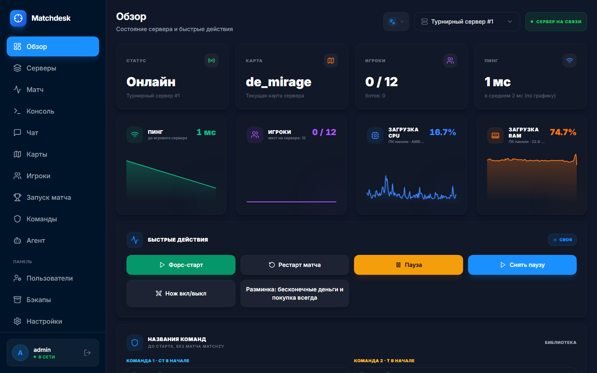
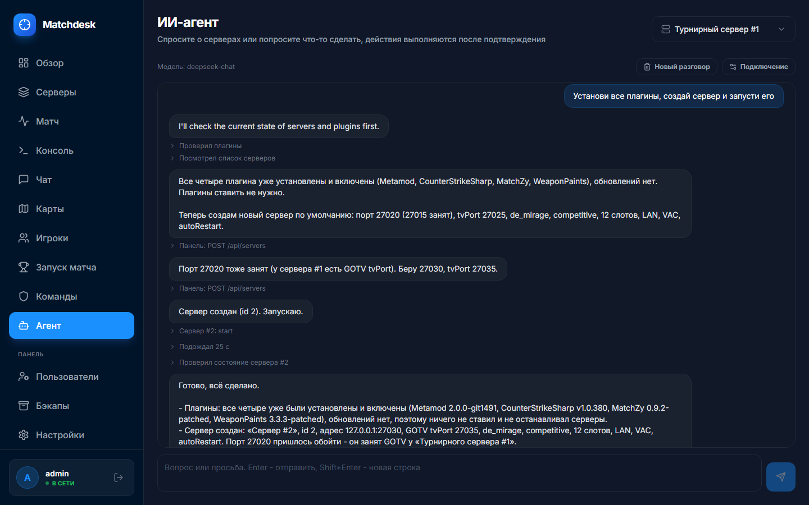
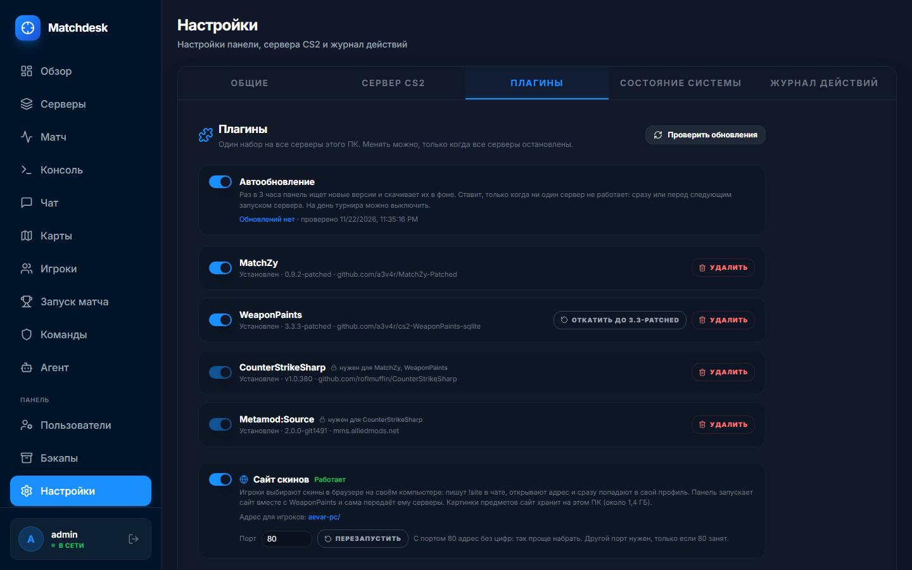
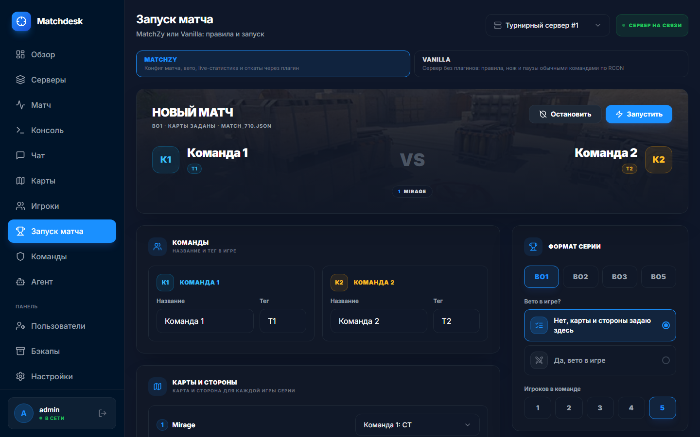

# Matchdesk

**English** | [Русский](README.ru.md)

A panel for CS2 tournaments on a local network. Everything lives on one PC: the CS2 server and its plugins, the match servers, the skins website for players and an AI agent. Referees run it from a browser on a laptop or phone.



## Features

**CS2 servers**
- Installs a CS2 dedicated server from scratch: downloads steamcmd and the server (about 60 GB) by itself, then updates it with one button.
- Creates servers: ports, map or Workshop map, game mode, slots, password, GOTV, GSLT, VAC, process priority, custom launch arguments and cfg lines.
- Starts, stops and restarts `cs2.exe` without console windows and brings a server back up if it crashes. Servers keep running while the panel restarts.
- Connects external servers over RCON too: on another PC or started outside the panel.

**Plugins**
- Installs and updates Metamod, CounterStrikeSharp, [MatchZy](https://github.com/a3v4r/MatchZy-Patched) and [WeaponPaints](https://github.com/a3v4r/cs2-WeaponPaints-sqlite) (forks for LAN tournaments); turns them on and off and rolls back to the previous version.
- Auto update: every 3 hours downloads new versions and installs them when no server is running.
- Warns when skins stop applying after a CS2 update and when the PC has no Visual C++ Redistributable.

**Matches**
- "Match setup": a MatchZy config (BO1-BO5, veto or maps and sides set in advance, rosters from the team library) goes to the server in one click.
- Vanilla mode for servers without MatchZy: 5v5 MR12 and 2v2 MR8 rules, knife round and pauses with plain CS2 commands.
- "Match": score, rounds, player stats (K/D/A, ADR, HS%, KAST, clutches), kill feed, round timer.
- Pause, force start, knife round and round restore. MatchZy saves a backup at the start of every round, so a match can go back to the start of any round played.

**Players and chat**
- Online players with ping, kick and ban (one ban list for all servers, from an hour to permanent), join and leave log.
- In-game chat history with search, chat messages, timed auto messages and templates.
- Team library: name, tag, flag, roster by SteamID (any form is accepted, profile links included).

**Skins website** for WeaponPaints
- A player types `!site` in chat, opens the address on their computer and lands in their profile with no login. Skins, knives, gloves, stickers, keychains, music kits and pins, separately for T and CT.
- Changes apply in game at once. Item pictures are stored on the panel PC, so they need no internet.
- The panel runs the website by itself (port 80), as a separate process with no access to the panel.

**AI agent**
- "Agent" tab: a chat with a language model that can do everything the panel does. "What is on the servers now?", "Why are skins not applied?", "Add a button for infinite money in warmup", "Restore 1 round", "Install all plugins, create a server and start it".
- Reads the state of servers, players, the match, chat, logs and plugins by itself. Any change is only proposed: it runs after the "Run" button and goes into the action log.
- Works with any OpenAI-compatible API: OpenRouter, DeepSeek, a local Ollama. Available only to the `admin` account.

**Other**
- "Overview": server status, ping, player and PC load charts, quick actions and custom command buttons.
- RCON console with command hints, maps and their configs, scheduled backups of the panel data and CS2 configs, a log of every action.
- Russian and English interface, mobile layout.

| Agent | Plugins | Match setup |
|---|---|---|
|  |  |  |

## Install

You need a PC with Windows 10 or 11 and 85 GB of free space for the CS2 server.

1. Download `Matchdesk.exe` from [Releases](https://github.com/a3v4r/Matchdesk/releases) and put it in a permanent folder, for example `C:\Matchdesk`. Nothing needs to be installed.
2. Run `Matchdesk.exe`. The file is not signed, so on the first run Windows may show "Windows protected your PC": "More info" → "Run anyway". The exe:
   - unpacks the panel next to itself into `app\`;
   - creates `matchdesk.ini` and the password of the `admin` account, shown in the window;
   - offers to install Microsoft Visual C++ Redistributable (Metamod and CounterStrikeSharp do not load without it) and to allow the panel in Windows Firewall; Windows asks for administrator rights for both;
   - shows the panel addresses. Keep the window open: it is the running panel, and it restarts the panel by itself if it crashes.
3. Open `http://<this PC's IP>:3000` from any device on the same network and sign in as `admin`.
4. "Servers" → "Install CS2". When the install finishes, press "Allow" in the "Firewall" row of the same window so players can connect to the servers.
5. "Settings" → "Plugins": turn on MatchZy and, if you want skins, WeaponPaints. Metamod and CounterStrikeSharp are turned on by themselves.
6. "Servers" → "Create Server", then start it.

Steps 4-6 can be given to the agent in one sentence once it is connected.

### Updating

Replace `Matchdesk.exe` with the new one from Releases and run it. The exe unpacks the new panel by itself; `data\` and `matchdesk.ini` stay as they were.

### Files next to the exe

| Path | What it is |
|---|---|
| `app\` | the panel itself, unpacked from the exe; do not edit |
| `data\` | panel data: servers, users, settings, teams, bans, action log, backups, plugin cache and the skins website's pictures |
| `matchdesk.ini` | panel port and the `admin` password |

The CS2 server is installed to `C:\cs2server\cs2` by default; the folder can be changed in "Settings" → "Server Engine".

## Accounts

At first there is one account, `admin`, with the password from `matchdesk.ini`. It creates personal accounts for other people in "Users". Everyone has the same full rights, except the agent: only `admin` can use it. Changing a password or deleting a user ends their sessions at once. Every action is logged with the name of whoever did it.

## Network

| Port | Who opens it |
|---|---|
| 3000 (TCP) | panel: referees; set in `matchdesk.ini` |
| 80 (TCP) | skins website: players; set in "Settings" → "Plugins" |
| 27015 and up (UDP) | CS2 servers: players; the port and the GOTV port are set per server |

Matchdesk adds the firewall rules by itself: for `Matchdesk.exe` (panel and skins website) and for `cs2.exe`.

The game servers also talk to the panel: MatchZy fetches the match config from it and sends match events, and the server sends its log with the chat. So the servers must reach the panel PC over the network; if they run on the same PC, this works on its own.

## AI agent

"Agent" → "Connection": choose a service (OpenRouter, DeepSeek or Ollama on this PC), paste the API key and choose a model. The model must support tool calling; for OpenRouter, the button next to the "Model" field lists such models with prices.

- The key is stored in `data\settings.json` on the panel PC and is never sent to the browser.
- The panel PC needs internet. The logs, nicknames and chat the agent reads are sent to the chosen service.
- The agent treats the server picked in the top right as the default server.
- The conversation is kept in the browser; "New chat" clears it.

## Without the exe

On Linux or with your own Node.js 22.13+, run the panel from the `matchdesk-<version>-app.zip` archive in Releases: `node server.js` in the unpacked folder, with environment variables.

| Variable | Purpose |
|---|---|
| `PANEL_PASSWORD` | `admin` password; without it sign-in is off and the panel is open to the whole network (development only) |
| `PORT`, `HOSTNAME` | panel port and address, for example `3000` and `0.0.0.0` |
| `PANEL_DATA_DIR` | data folder, `./data` by default |
| `CS2_DIR` | CS2 server folder if it is not set in the settings; `C:\cs2server\cs2` by default |

Installing CS2, plugins and starting servers are made for Windows.

## Development

```bash
npm install
npm run dev        # http://localhost:3000, no password
npm run package    # .next/standalone: the panel for node server.js
npm run exe        # dist\Matchdesk.exe (needs Node.js 25.5+)
```

| Folder | What is there |
|---|---|
| `src/app` | panel pages and API (Next.js App Router) |
| `src/components` | interface |
| `src/server` | server side: RCON, A2S, starting servers, plugins, matches, skins website, agent |
| `skins-site/` | the skins website, Node with no dependencies |
| `launcher/main.cjs` | the launcher inside `Matchdesk.exe` |
| `scripts/` | standalone and exe builds |
| `docs/STATE.md` | current project state and notes for the next sessions (in Russian) |

GitHub Actions builds a release on every push to `main`: the version comes from `package.json`, and the release gets `Matchdesk.exe` and `matchdesk-<version>-app.zip`.

Stack: Next.js 15, React 18, Tailwind CSS, Radix UI, Lucide. RCON and A2S are written without external libraries; data is stored in JSON files.

---
*Made by the Aevarx team.*
