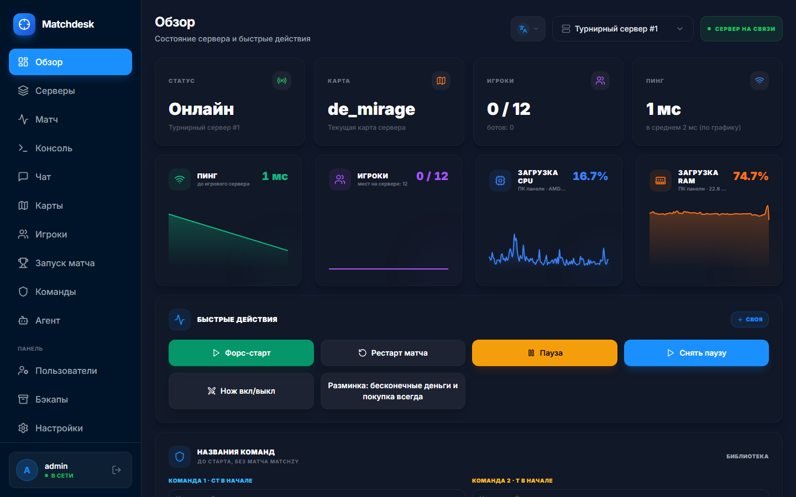
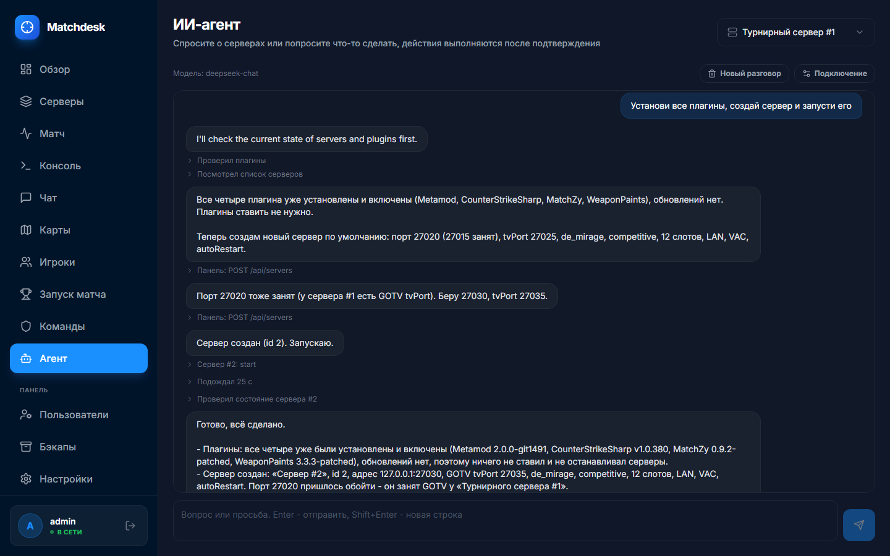
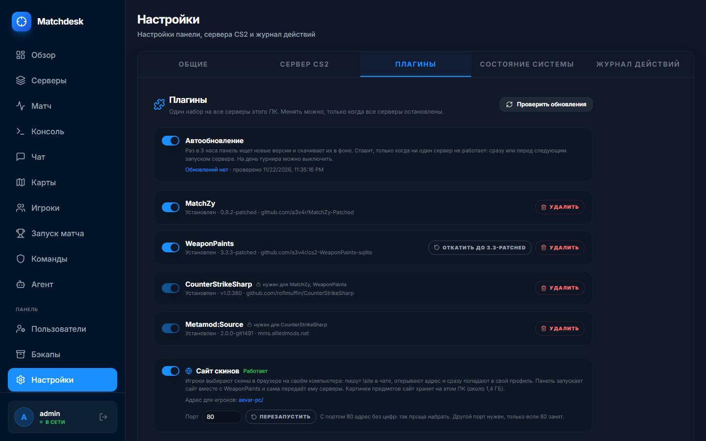
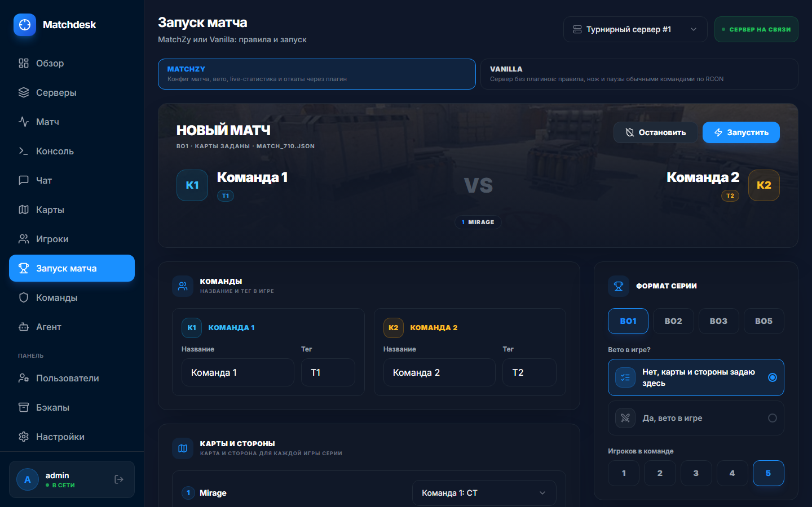

# Matchdesk

[English](README.md) | **Русский**

Панель для турниров CS2 в локальной сети. Всё живёт на одном ПК: сервер CS2 и его плагины, серверы матчей, сайт скинов для игроков и ИИ-агент. Судьи управляют этим из браузера с ноутбука или телефона.



## Что умеет

**Серверы CS2**
- Ставит выделенный сервер CS2 с нуля: сама скачивает steamcmd и сервер (около 60 ГБ), потом обновляет его одной кнопкой.
- Создаёт серверы: порты, карта или карта из Workshop, режим игры, слоты, пароль, GOTV, GSLT, VAC, приоритет процесса, свои аргументы запуска и строки cfg.
- Запускает, останавливает и перезапускает `cs2.exe` без окон консоли и поднимает сервер снова, если он упал. Серверы продолжают работать, когда панель перезапускают.
- Подключает и внешние серверы по RCON: с другого ПК или запущенные не из панели.

**Плагины**
- Ставит и обновляет Metamod, CounterStrikeSharp, [MatchZy](https://github.com/a3v4r/MatchZy-Patched) и [WeaponPaints](https://github.com/a3v4r/cs2-WeaponPaints-sqlite) (форки под LAN-турниры), включает, выключает и откатывает на прошлую версию.
- Автообновление: раз в 3 часа скачивает новые версии и ставит, когда ни один сервер не работает.
- Предупреждает, когда скины перестали применяться после обновления CS2, и когда на ПК нет Visual C++ Redistributable.

**Матчи**
- «Запуск матча»: конфиг MatchZy (BO1-BO5, вето или карты и стороны заранее, составы из библиотеки команд) уходит на сервер в один клик.
- Режим Vanilla для серверов без MatchZy: правила 5на5 MR12 и 2на2 MR8, ножевой раунд и паузы обычными командами CS2.
- «Матч»: счёт, раунды, статистика игроков (K/D/A, ADR, HS%, KAST, клатчи), лента убийств, таймер раунда.
- Пауза, форс-старт, ножевой раунд и откат раунда. MatchZy сохраняет бэкап в начале каждого раунда, откатить можно к началу любого сыгранного раунда.

**Игроки и чат**
- Игроки онлайн с пингом, кик и бан (бан-лист общий на все серверы, сроки от часа до навсегда), журнал входов и выходов.
- История игрового чата с поиском, сообщения в чат, автосообщения по таймеру и шаблоны.
- Библиотека команд: название, тег, флаг, состав по SteamID (принимается в любом виде, включая ссылку на профиль).

**Сайт скинов** для WeaponPaints
- Игрок пишет `!site` в чате, открывает адрес на своём компьютере и сразу попадает в свой профиль, без логина. Скины, ножи, перчатки, наклейки, брелоки, музыка и значки, отдельно для T и CT.
- Изменения применяются в игре сразу. Картинки предметов хранятся на ПК с панелью, интернет для них не нужен.
- Панель запускает сайт сама (порт 80), отдельный процесс без доступа к панели.

**ИИ-агент**
- Вкладка «Агент»: чат с языковой моделью, которая может всё, что умеет панель. «Что сейчас на серверах?», «Почему не применяются скины?», «Добавь кнопку с бесконечными деньгами на разминке», «Откати 1 раунд», «Установи все плагины, создай сервер и запусти его».
- Сам читает состояние серверов, игроков, матча, чат, логи и плагины. Любое изменение только предлагает: оно выполняется после кнопки «Выполнить» и попадает в журнал действий.
- Работает с любым OpenAI-совместимым API: OpenRouter, DeepSeek, локальная Ollama. Доступен только аккаунту `admin`.

**Прочее**
- «Обзор»: состояние сервера, графики пинга, игроков и нагрузки ПК, быстрые действия и свои кнопки с командами.
- Консоль RCON с подсказками команд, карты и их конфиги, бэкапы данных панели и конфигов CS2 по расписанию, журнал всех действий.
- Русский и английский интерфейс, вёрстка под телефон.

| Агент | Плагины | Запуск матча |
|---|---|---|
|  |  |  |

## Установка

Нужен ПК с Windows 10 или 11 и 85 ГБ свободного места под сервер CS2.

1. Скачайте `Matchdesk.exe` из [Releases](https://github.com/a3v4r/Matchdesk/releases) и положите в постоянную папку, например `C:\Matchdesk`. Устанавливать ничего не нужно.
2. Запустите `Matchdesk.exe`. Файл не подписан, поэтому при первом запуске Windows может показать «Windows защитила ваш компьютер»: «Подробнее» → «Выполнить в любом случае». Exe:
   - распаковывает панель рядом с собой в `app\`;
   - создаёт `matchdesk.ini` и пароль аккаунта `admin`, пароль виден в окне;
   - предлагает установить Microsoft Visual C++ Redistributable (без него не загрузятся Metamod и CounterStrikeSharp) и разрешить панель в брандмауэре Windows; на оба Windows спросит права администратора;
   - показывает адреса панели. Окно не закрывайте: это и есть работающая панель, при падении она перезапускается сама.
3. Откройте `http://<IP этого ПК>:3000` с любого устройства в той же сети и войдите как `admin`.
4. «Серверы» → «Установить CS2». Когда установка закончится, в том же окне нажмите «Разрешить» в строке «Брандмауэр», чтобы игроки могли подключиться к серверам.
5. «Настройки» → «Плагины»: включите MatchZy и, если нужны скины, WeaponPaints. Metamod и CounterStrikeSharp включатся сами.
6. «Серверы» → «Создать сервер», потом запустите его.

Шаги 4-6 можно поручить агенту одной фразой, если он подключён.

### Обновление

Замените `Matchdesk.exe` новым из Releases и запустите. Exe сам распакует новую панель; `data\` и `matchdesk.ini` останутся как были.

### Что лежит рядом с exe

| Путь | Что это |
|---|---|
| `app\` | сама панель, распаковывается из exe, руками не трогать |
| `data\` | данные панели: серверы, пользователи, настройки, команды, баны, журнал действий, бэкапы, кэш плагинов и картинок сайта скинов |
| `matchdesk.ini` | порт панели и пароль `admin` |

Сервер CS2 по умолчанию ставится в `C:\cs2server\cs2`, папку можно поменять в «Настройки» → «Сервер CS2».

## Аккаунты

Сначала есть один аккаунт `admin` с паролем из `matchdesk.ini`. Остальным людям он заводит личные аккаунты в разделе «Пользователи». Права у всех одинаковые и полные, кроме агента: он доступен только `admin`. Смена пароля или удаление пользователя сразу завершают его сессии. Каждое действие записывается в журнал с именем того, кто его сделал.

## Сеть

| Порт | Кто открывает |
|---|---|
| 3000 (TCP) | панель: судьи; меняется в `matchdesk.ini` |
| 80 (TCP) | сайт скинов: игроки; меняется в «Настройки» → «Плагины» |
| 27015 и дальше (UDP) | серверы CS2: игроки; порт и порт GOTV задаются у каждого сервера |

Правила брандмауэра добавляет сам Matchdesk: для `Matchdesk.exe` (панель и сайт скинов) и для `cs2.exe`.

Игровые серверы тоже обращаются к панели: MatchZy забирает с неё конфиг матча и присылает события матча, сервер присылает лог с чатом. Поэтому серверы должны видеть ПК с панелью по сети; если они на этом же ПК, всё работает само.

## ИИ-агент

«Агент» → «Подключение»: выберите сервис (OpenRouter, DeepSeek или Ollama на этом ПК), вставьте ключ API и выберите модель. Модель должна уметь вызывать инструменты (tool calling); для OpenRouter кнопка рядом с полем «Модель» покажет такие модели с ценами.

- Ключ хранится в `data\settings.json` на ПК с панелью и в браузер не отдаётся.
- Нужен интернет на ПК с панелью. Логи, ники и чат, которые агент читает, уходят выбранному сервису.
- Сервер, выбранный справа сверху, агент считает сервером по умолчанию.
- Разговор хранится в браузере, «Новый разговор» его стирает.

## Без exe

На Linux или со своим Node.js 22.13+ запускайте панель из архива `matchdesk-<версия>-app.zip` в Releases: `node server.js` в распакованной папке с переменными окружения.

| Переменная | Назначение |
|---|---|
| `PANEL_PASSWORD` | пароль `admin`; без него вход отключён и панель открыта всем в сети (только для разработки) |
| `PORT`, `HOSTNAME` | порт и адрес панели, например `3000` и `0.0.0.0` |
| `PANEL_DATA_DIR` | папка данных, по умолчанию `./data` |
| `CS2_DIR` | папка сервера CS2, если она не задана в настройках; по умолчанию `C:\cs2server\cs2` |

Установка CS2, плагины и запуск серверов рассчитаны на Windows.

## Разработка

```bash
npm install
npm run dev        # http://localhost:3000, без пароля
npm run package    # .next/standalone: панель для node server.js
npm run exe        # dist\Matchdesk.exe (нужен Node.js 25.5+)
```

| Папка | Что там |
|---|---|
| `src/app` | страницы и API панели (Next.js App Router) |
| `src/components` | интерфейс |
| `src/server` | серверная часть: RCON, A2S, запуск серверов, плагины, матчи, сайт скинов, агент |
| `skins-site/` | сайт скинов, Node без зависимостей |
| `launcher/main.cjs` | запускалка внутри `Matchdesk.exe` |
| `scripts/` | сборка standalone и exe |
| `docs/STATE.md` | текущее состояние проекта и находки для следующих сессий |

Релиз собирает GitHub Actions при каждом пуше в `main`: версия берётся из `package.json`, в релиз уходят `Matchdesk.exe` и `matchdesk-<версия>-app.zip`.

Стек: Next.js 15, React 18, Tailwind CSS, Radix UI, Lucide. RCON и A2S написаны без внешних библиотек, данные хранятся в JSON-файлах.

---
*Разработано командой Aevarx.*
